  

  

  

  <b>Completed missions</b> 
  <a href="https://github.com/lucasleandro08/claude-mods">A-rank · claude-mods</a> &nbsp;·&nbsp;
  <a href="https://github.com/lucasleandro08/llm-knowledge-base-template">B-rank · llm-knowledge-base-template</a> &nbsp;·&nbsp;
  <a href="https://github.com/lucasleandro08/filemorph">C-rank · filemorph</a>

  
  

