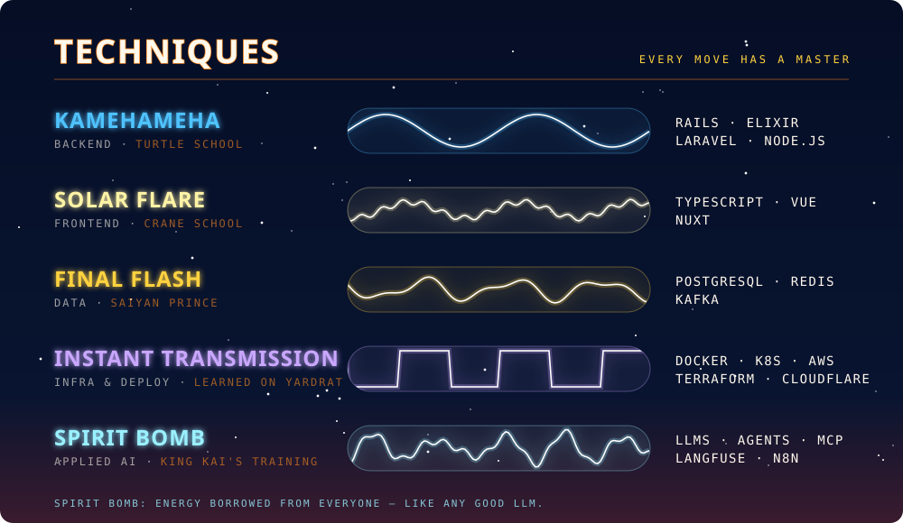

  

  

  

  <b>Dragon balls in plain sight</b> 
  <a href="https://github.com/lucasleandro08/claude-mods">★ claude-mods</a> &nbsp;·&nbsp;
  <a href="https://github.com/lucasleandro08/llm-knowledge-base-template">★★ llm-knowledge-base-template</a> &nbsp;·&nbsp;
  <a href="https://github.com/lucasleandro08/filemorph">★★★ filemorph</a>

  
  

