  

  

  

<h3 align="center">Arsenal</h3>

  <a href="https://github.com/lucasleandro08/claude-mods"><b>claude-mods</b></a> — Dracula-themed Claude Code mods: live diff pane, Kubernetes pods pane, PR dashboard, guardrails 
  <a href="https://github.com/lucasleandro08/llm-knowledge-base-template"><b>llm-knowledge-base-template</b></a> — self-compiling personal knowledge base for Claude Code conversations 
  <a href="https://github.com/lucasleandro08/filemorph"><b>filemorph</b></a> — 100% client-side file converter · <a href="https://filemorph-nu.vercel.app">live</a>

  
  

